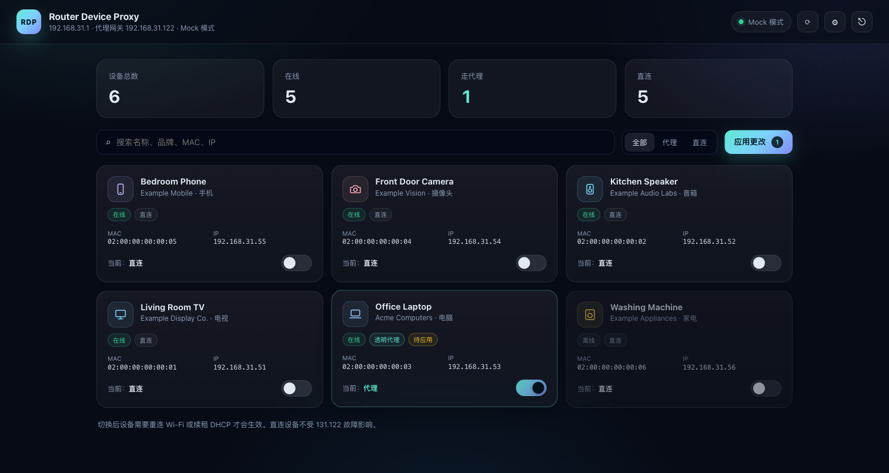

# Router Device Proxy

按设备选择 **直连** 或 **透明代理** 的轻量 Web 控制台。默认设备继续走主路由直连，只有被标记的设备通过旁路由（OpenClash / Clash）上网；旁路由故障不会影响直连设备。

设备列表通过 SSH 读取，名称会用 DNS PTR、NetBIOS、mDNS、LLMNR 和 SSDP/UPnP 自动补全。



## 功能

- 自动扫描路由器下的设备：名称、品牌、MAC、IP、在线状态
- 名称补全：DHCP 租约 + DNS PTR / NetBIOS / mDNS / LLMNR / SSDP
- 按设备切换 `直连 / 透明代理`
- 通过 dnsmasq 的 `dhcp-host` + `dhcp-option` 下发网关/DNS，设备续租后生效
- 策略持久化：容器数据卷 + 路由器 `/data` + 开机 hook
- 单密码登录；路由器 SSH 密码/私钥加密保存在数据卷
- 单二进制 + 嵌入前端，Docker 镜像基于 `scratch`，约 10–12MB

## 工作原理

```text
浏览器
  │
  ▼
:8090  Go 单二进制（嵌入 UI）
  ├─ 设备扫描：SSH（dnsmasq leases + ip neigh + /proc/net/arp）
  ├─ 名称补全：DNS PTR / NetBIOS / mDNS / LLMNR / SSDP
  ├─ 策略：/data/policy.json
  └─ SSH → 路由器
        ├─ /data/dnsmasq.d/proxy.conf   （持久）
        ├─ /tmp/dnsmasq.d/proxy.conf    （生效）
        └─ /etc/init.d/dnsmasq restart
```

代理设备会得到：

```conf
dhcp-host=AA:BB:CC:DD:EE:FF,set:proxy,192.168.31.50
dhcp-option=tag:proxy,3,192.168.31.122
dhcp-option=tag:proxy,6,192.168.31.122
```

未标记设备继续使用主路由下发的网关/DNS，直连不受旁路由影响。

## 设备名称来源

| 来源 | 说明 |
|---|---|
| DHCP lease | 客户端主动上报的 hostname；很多手机/IoT 不传 |
| DNS PTR | dnsmasq 已知的租约/静态主机名 |
| NetBIOS | Windows / Samba 计算机名 |
| mDNS | Apple / IoT / 打印机等的 `.local` 名称 |
| LLMNR | Windows / systemd-resolved 本地名称 |
| SSDP/UPnP | 电视、NAS、路由器的 `friendlyName` |
| 小米本地设备库 | 只读解析 `/data/etc/xqDb` 的 `DEVICE_INFO`，自动获取 `Redmi-K50` 等显示名，不需要密码 |
| 小米后台接口（可选） | 本地 `misystem/devicelist`，需要小米后台密码；作为 xqDb 的补充 |
| OUI | 厂商名（已内置） |

补全结果缓存 10 分钟，且不会覆盖 DHCP 已经上报的名称。SSDP 依赖组播，容器需要使用 `--network host`；bridge 模式仍可跑 DNS/NetBIOS/mDNS 的单播回退。

小米后台里的 `Redmi-K50` 这类名字来自小米自己的设备库；本工具优先通过 SSH 只读解析 `/data/etc/xqDb`，不需要后台密码。`misystem/devicelist` 接口是可选的补充。

## 快速开始

```bash
cp .env.example .env
# 修改 .env 里的 ADMIN_PASSWORD
docker compose up -d --build
```

打开 `http://<运行主机>:8090`，输入 `ADMIN_PASSWORD` 登录。

### 直接使用 docker run

```bash
docker run -d \
  --name router-device-proxy \
  --restart always \
  --network host \
  -e ADDR=192.168.31.122:18099 \
  -e TZ=Asia/Shanghai \
  -e ADMIN_PASSWORD="$(cat /path/to/admin-password.txt)" \
  -e ROUTER_HOST=192.168.31.1 \
  -e ROUTER_USER=root \
  -e ROUTER_PASSWORD='你的路由器 SSH 密码' \
  -e ROUTER_WEB_PASSWORD='你的小米后台密码' \
  -e PROXY_GATEWAY=192.168.31.122 \
  -e ROUTER_LEASE_FILE=/tmp/dhcp.leases \
  -v /path/to/data:/data \
  <DOCKERHUB_USERNAME>/router-device-proxy:latest
```

`ROUTER_WEB_PASSWORD` 也可以留空，之后在设置页填写；它只用于读取 Xiaomi 设备显示名。

`--network host` 是 SSDP/UPnP 发现所需要的；`ADDR` 建议绑定旁路由 LAN IP（例如 `192.168.31.122:18099`），18099 被占用时换成其他空闲端口。如果容器跑在旁路由上，再加 `--hostname <旁路由主机名>`，旁路由自己也会显示名称。

如果只能用 bridge 网络，把 `--network host` 换成 `-p 18099:8090` 并去掉 `ADDR`；DNS/NetBIOS/mDNS 仍可用，SSDP 不会工作。

也可以直接用 `-e ADMIN_PASSWORD='...'`，不一定要密码文件。

首次登录后点右上角 **⚙ 设置**：

| 字段 | 说明 |
|---|---|
| 路由器 IP | 主路由地址，例如 `192.168.31.1` |
| SSH 用户 | 通常是 `root` |
| 代理网关 | 旁路由地址，例如 `192.168.31.122` |
| DHCP leases 路径 | 默认 `/tmp/dhcp.leases`；不同固件可改 |
| SSH 密码 / SSH 私钥 | 二选一；保存后加密存放在数据卷，不需要每次输入 |
| 小米后台密码 | 可选补充；名称优先从 `/data/etc/xqDb` 自动读取，不需要密码 |

点 **测试连接** 验证 SSH，点 **安装开机持久化** 在路由器上写入 `/data/dnsmasq.d/restore.sh` 并挂到防火墙 include，重启后自动恢复。

## 环境变量

| 变量 | 默认 | 说明 |
|---|---|---|
| `ADMIN_PASSWORD` | 必填 | Web 登录密码 |
| `ADDR` | `:8090` | 监听地址；host 网络下就是宿主机端口 |
| `DATA_DIR` | `/data` | 数据卷 |
| `ROUTER_HOST` | `192.168.31.1` | 主路由 IP |
| `ROUTER_USER` | `root` | SSH 用户 |
| `ROUTER_PASSWORD` | 空 | SSH 密码（也可在设置页保存） |
| `ROUTER_KEY` | 空 | SSH 私钥内容（也可在设置页保存） |
| `ROUTER_WEB_PASSWORD` | 空 | 小米后台密码，可选；名称优先从 xqDb 自动读取 |
| `XIAOMI_XQDB` | `/data/etc/xqDb` | 小米本地设备库路径；只读解析 |
| `ROUTER_LEASE_FILE` | `/tmp/dhcp.leases` | dnsmasq 租约文件路径 |
| `PROXY_GATEWAY` | `192.168.31.122` | 旁路由网关 |
| `ROUTER_CONF_DIR` | `/data/dnsmasq.d` | 路由器持久配置目录 |
| `ROUTER_TMP_DIR` | `/tmp/dnsmasq.d` | dnsmasq 实际读取目录 |
| `ROUTER_RESTART_CMD` | `/etc/init.d/dnsmasq restart` | 应用后重启 dnsmasq 的命令 |
| `DISCOVERY` | `true` | 启用名称补全（DNS/NetBIOS/mDNS/LLMNR） |
| `DISCOVERY_SSDP` | `true` | 启用 SSDP/UPnP；需要 host 网络 |
| `DISCOVERY_TIMEOUT` | `2s` | 单个协议的超时 |
| `MOCK` | `false` | 本地 UI 调试模式，不连路由器 |

## 路由器要求

- 路由器可通过 SSH 读取 dnsmasq leases（默认 `/tmp/dhcp.leases`）和 `ip neigh` / `/proc/net/arp`
- dnsmasq 使用 `conf-dir=/tmp/dnsmasq.d`（OpenWrt 默认符合；其他固件可改 `ROUTER_CONF_DIR` / `ROUTER_TMP_DIR`）
- 路由器支持写 `/data` 或等效持久分区
- 旁路由已配置透明代理和 DNS（本项目只负责下发网关/DNS，不修改 OpenClash 配置）

## 安全说明

- 只监听 LAN，不要把端口暴露到公网
- Web 使用单密码 + HttpOnly 会话 cookie
- 路由器密码/私钥/小米后台密码使用 AES-GCM 加密，密钥由 `ADMIN_PASSWORD` 派生
- 小米后台登录走本地 HTTP，发送 nonce 绑定的 SHA1 摘要，不发送明文；仍建议只在可信 LAN 使用
- SSH 使用 `InsecureIgnoreHostKey`，适合可信 LAN；如需严格校验可自行扩展
- 容器以 root 运行以写数据卷；如要降权，请自行调整卷权限

## 本地开发

需要 Go 1.27.1+；`go.mod` 已声明，Go 1.21+ 会自动下载工具链。

```bash
ADMIN_PASSWORD=test MOCK=1 DATA_DIR=./data go run .
```

打开 `http://127.0.0.1:8090`，密码 `test`，会看到 6 台模拟设备。

```bash
go test ./...
go build -trimpath -ldflags="-s -w" -o rdp .
```

## 镜像与 GitHub Actions

`.github/workflows/docker.yml` 在 push 到 `main` 或 `v*` tag 时构建并推送：

- `DOCKERHUB_USERNAME/router-device-proxy:latest`
- `DOCKERHUB_USERNAME/router-device-proxy:<sha>`

需要在仓库 Secrets 中设置：

- `DOCKERHUB_USERNAME`
- `DOCKERHUB_TOKEN`

## 限制

- DHCP 下发需要设备重连/续租后生效
- 目前只处理 IPv4；IPv6 分流未实现
- 开机持久化 hook 面向 OpenWrt/dnsmasq；其他系统需自行适配
- 名称补全依赖设备是否响应 DNS/NetBIOS/mDNS/SSDP；小米私有设备名可通过可选的小米后台密码读取
- 小米名称优先读本地 xqDb（只读）；后台接口是可选补充，固件升级可能变化
- 品牌识别依赖 OUI 库，未知设备显示 `未知设备`

## 架构

多品牌兼容设计见 [docs/architecture-multi-brand.md](docs/architecture-multi-brand.md)。

## License

MIT
